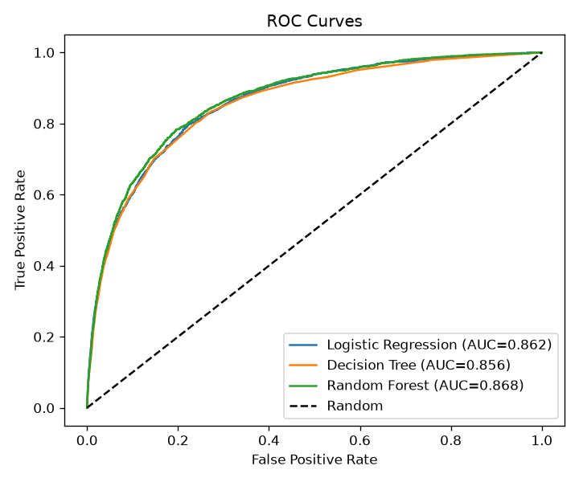
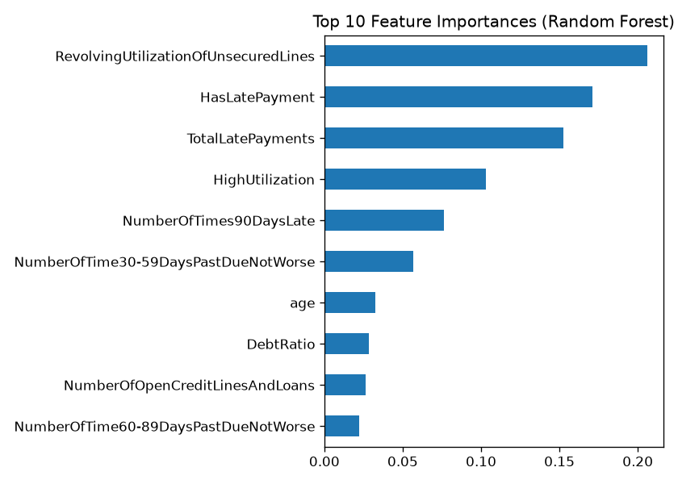

# 💳 Credit Scoring Model

Predicts whether a borrower will default within 2 years using their
financial history. Built with Python and scikit-learn.

## 📊 Dataset
[Give Me Some Credit (Kaggle)](https://www.kaggle.com/c/GiveMeSomeCredit):
150,000 borrowers, about 7% defaulters (highly imbalanced).

## 🔧 Approach
1. Data cleaning (invalid ages, placeholder codes, outliers)
2. Feature engineering (total late payments, utilization flags, debt per credit line, etc.)
3. Stratified train/test split with a leakage-free sklearn Pipeline
4. Models: Logistic Regression, Decision Tree, Random Forest
5. Class-weight balancing, GridSearchCV tuning, threshold tuning

## 📈 Results
| Model | Precision | Recall | F1 | ROC-AUC |
|---|---|---|---|---|
| Logistic Regression | ___ | ___ | ___ | ___ |
| Decision Tree | ___ | ___ | ___ | ___ |
| Random Forest | ___ | ___ | ___ | ___ |

**Best model:** ___ (ROC-AUC = ___)

### ROC Curves

### Feature Importance

## 🔍 Key Insights
- Top risk drivers: ___, ___, ___
- Accuracy is misleading here because only ~7% of borrowers default,
  so I evaluated with Precision, Recall, F1 and ROC-AUC.
- Missing a defaulter costs a bank more than rejecting a good customer,
  so recall is prioritized and the decision threshold is tuned.

## ▶️ How to Run
1. Clone the repo and install dependencies:
   `pip install -r requirements.txt`
2. Download `cs-training.csv` from the Kaggle link above and place it in this folder.
3. Run: `python credit_scoring.py`

## 🚀 Future Improvements
XGBoost/LightGBM, SMOTE comparison, SHAP explanations